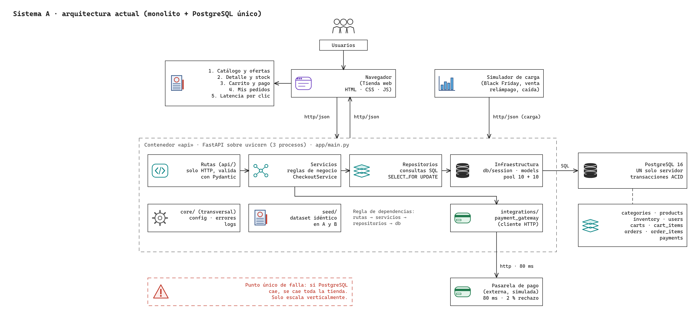
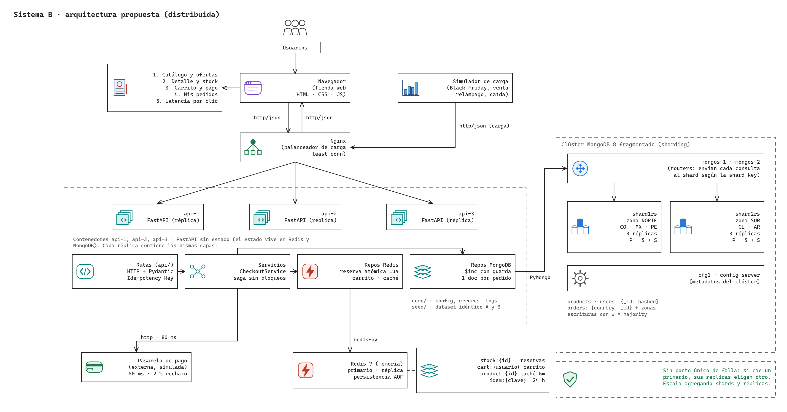
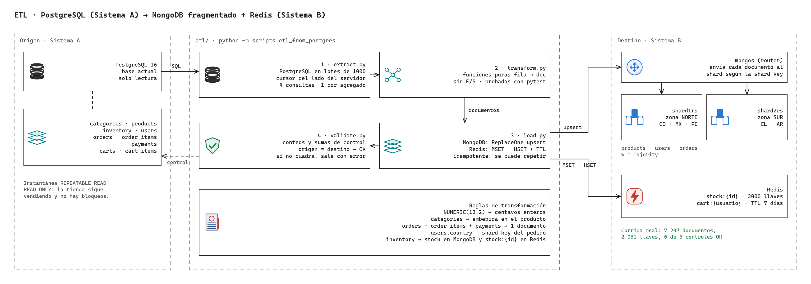

# CompraYa — Base de datos distribuida para una tienda en línea con alta demanda

Proyecto final · Bases de datos modernas · **Opción 1**

CompraYa vende tecnología en varios países de Latinoamérica. En Black Friday su
sistema (un solo PostgreSQL) sufre lentitud, bloqueos, fallas de pago y pérdida
de carritos. Este repositorio contiene **dos proyectos completos con la misma API**
para compararlos con datos reales:

| Carpeta | Qué es |
|---|---|
| [`sistema-a-actual/`](sistema-a-actual/) | El sistema que plantea el enunciado: FastAPI + **PostgreSQL único** |
| [`sistema-b-distribuido/`](sistema-b-distribuido/) | Nuestra propuesta: FastAPI ×3 + Nginx + **MongoDB sharded (2 shards × 3 réplicas, zonas por región)** + **Redis** |
| [`simulador/`](simulador/) | **Panel web de pruebas en vivo**: Black Friday, venta relámpago y caída de un nodo contra A y B |
| [`pruebas-comparativas/`](pruebas-comparativas/) | Las mismas pruebas por línea de comandos (Locust) + gráficas para la presentación |

## Arquitectura

| Sistema A (actual) | Sistema B (propuesto) |
|---|---|
|  |  |

### ETL de migración (PostgreSQL → MongoDB + Redis)



Código en [`sistema-b-distribuido/etl/`](sistema-b-distribuido/etl/); se corre con `python -m scripts.etl_from_postgres`.

Los archivos `.excalidraw` de `docs/arquitectura/` se abren y editan en https://excalidraw.com.

## Resultados (corrida incluida, 1 máquina de 2 núcleos)

| Prueba | A · PostgreSQL único | B · Distribuido |
|---|---|---|
| Carga general, 300 usuarios — peticiones/s | 366 | **496** (+36 %) |
| Carga general, 300 usuarios — latencia p95 | 1 200 ms | **520 ms** |
| Checkout p95 con 300 usuarios | 3 100 ms | **980 ms** |
| Venta relámpago, 200 compradores — compras/s | 10 | **34** |
| Venta relámpago, 200 compradores — errores 500 | 17 | **0** |
| Caída de un nodo de BD | 30 s sin vender (hasta reparación manual) | **~8 s** y se recupera solo |
| Ventas por encima del stock | 0 | 0 |

Detalle en [`pruebas-comparativas/resultados/resumen.md`](pruebas-comparativas/resultados/resumen.md)
y gráficas en [`pruebas-comparativas/graficas/`](pruebas-comparativas/graficas/).

## Inicio rápido

```bash
cd sistema-a-actual && cp .env.example .env && docker compose up -d --build
docker compose exec api python -m scripts.seed

cd ../sistema-b-distribuido && cp .env.example .env && docker compose up -d --build
docker compose exec api-1 python -m scripts.seed

cd ../simulador && cp .env.example .env && docker compose up -d --build
```

| Qué | Dónde |
|---|---|
| Tienda del Sistema A | <http://localhost:8001> (API en `/docs`) |
| Tienda del Sistema B | <http://localhost:8002> (API en `/docs`) |
| Simulador de pruebas | <http://localhost:8010> |

Para la demo: abre el simulador y las dos tiendas en pestañas, lanza una **venta relámpago** y
mira cómo baja el stock de la oferta estrella en cada tienda mientras las gráficas comparan A y B.

## Decisiones de diseño compartidas

- **Misma API, mismos datos, misma pasarela de pago simulada** (80 ms, 2 % de rechazos):
  lo único que cambia entre A y B es la capa de datos y su despliegue.
- **Capas con una sola responsabilidad**: `routes` (HTTP) → `services` (reglas de negocio)
  → `repositories` (acceso a datos) → `db` (conexiones). La configuración vive solo en
  `core/config.py`; el cableado solo en `api/deps.py`.
